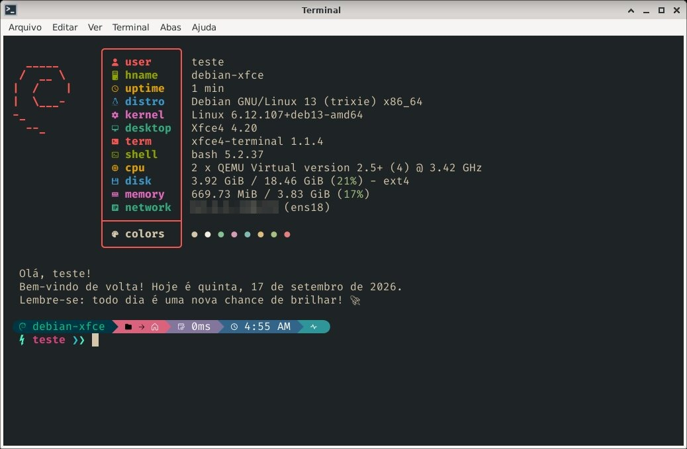
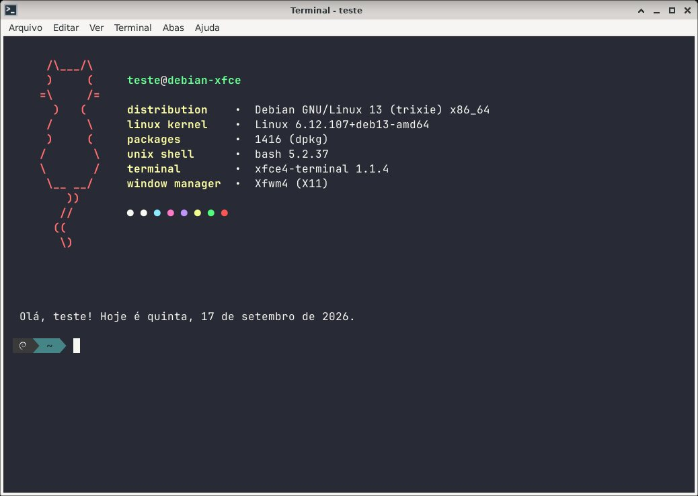
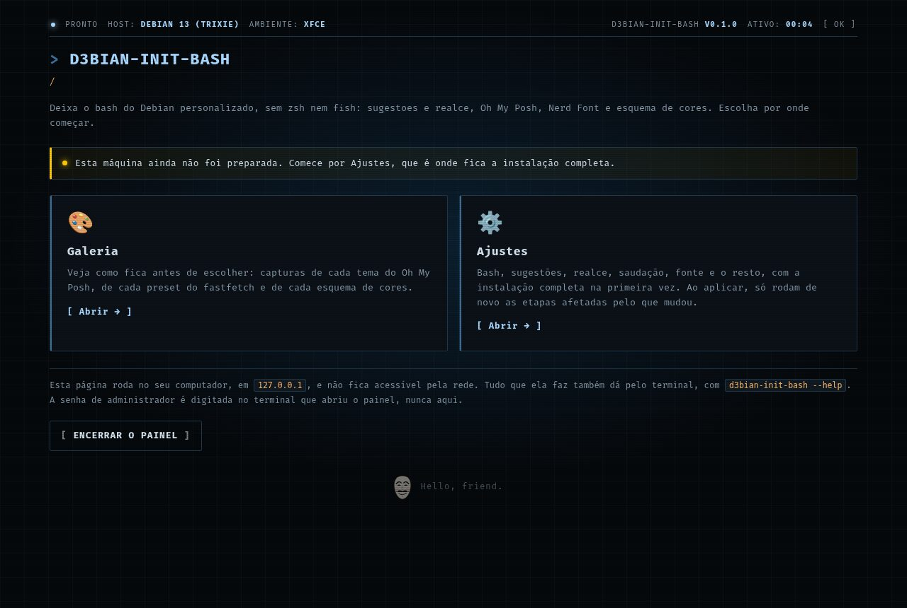
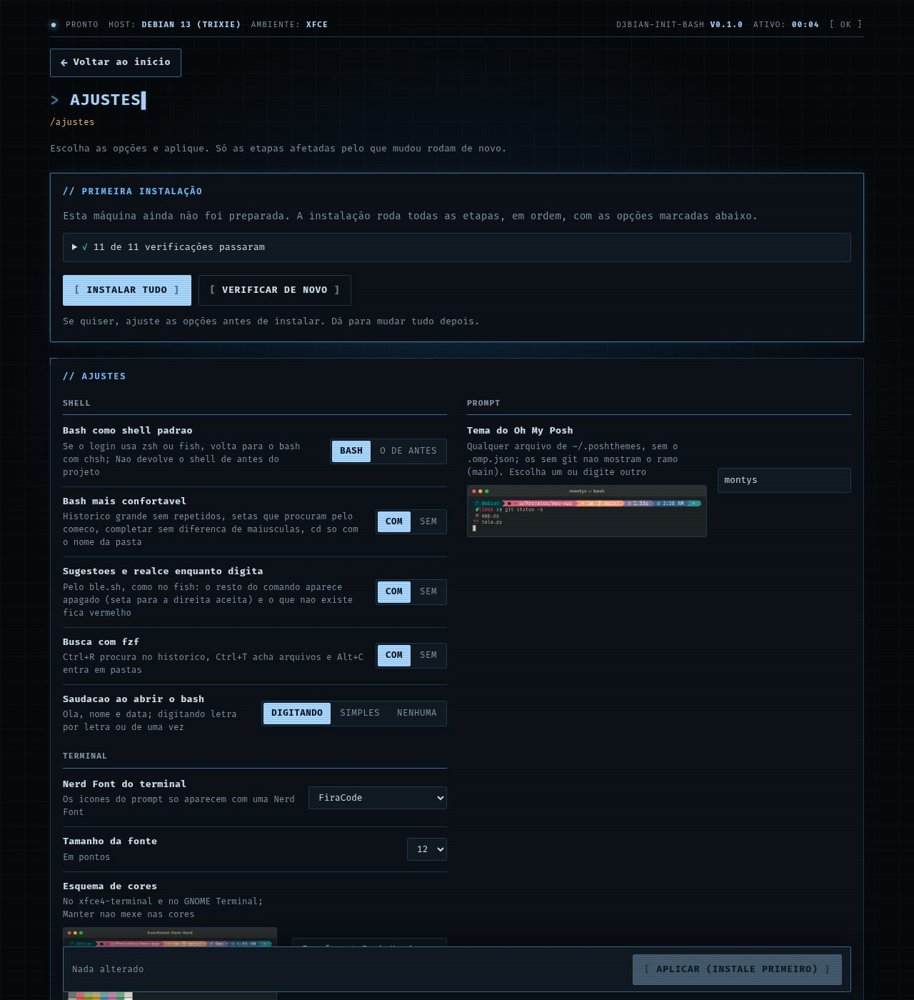
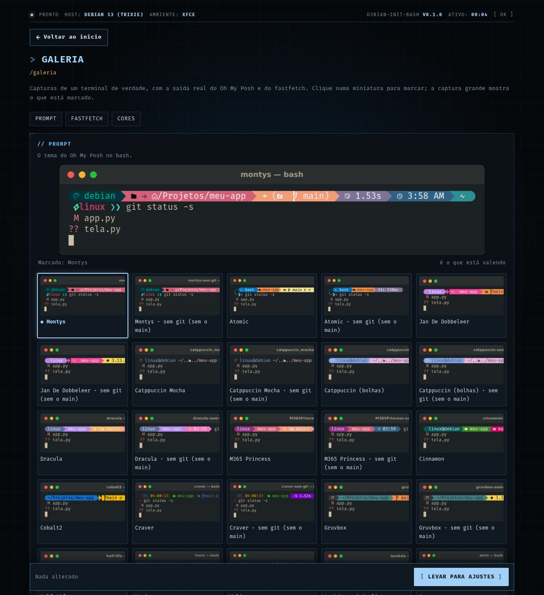
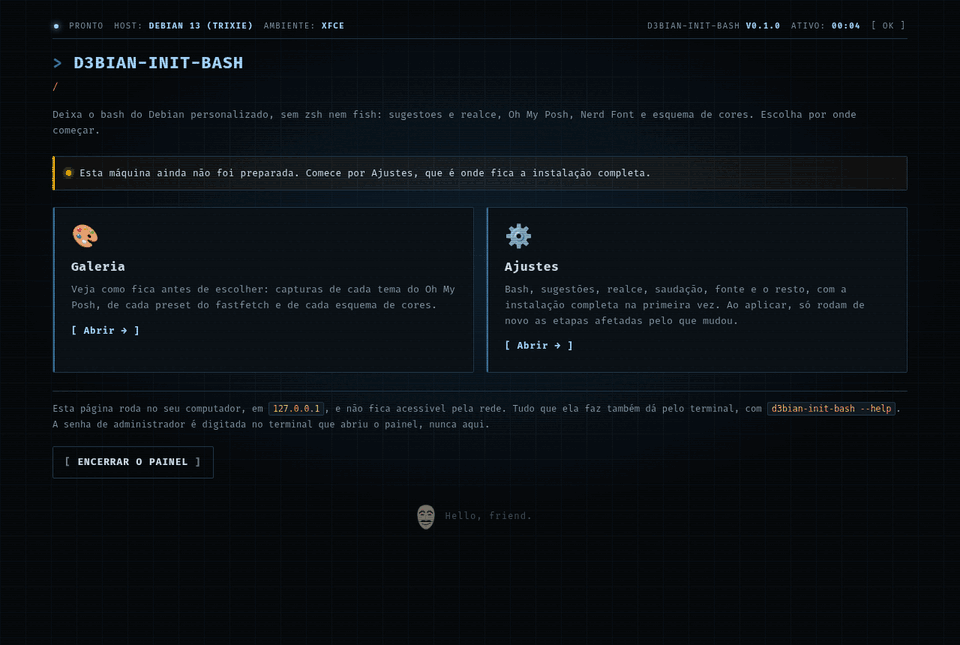

<div align="center">


**O bash de sempre, bonito em poucos cliques: sugestões e realce, Oh My Posh, Nerd Font e cores.**

[](docs/desenvolvimento.md)
[](docs/desenvolvimento.md)
[](docs/uso.md#sistemas)
[](docs/uso.md#ordem-dos-arquivos-do-bash)
[](LICENSE)

</div>

> Um painel local, aberto no navegador, que deixa o terminal do Debian (e do
> Ubuntu/Mint) personalizado **só com o bash**, sem zsh e sem fish: o mesmo
> prompt, fonte, cores e fastfetch dos irmãos. Escolha vendo, aplique, e volte ao
> que era antes quando quiser. Só Python da biblioteca padrão — nada de pip.

```sh
git clone https://github.com/diego-luz/d3bian-bash.git d3bian_init_bash
python3 -m d3bian_init_bash            # pede a senha uma vez e abre o painel
```

<div align="center">
  
</div>

---

## O que ele faz

- **Bash** como shell padrão, com o básico que o fish traz ligado: histórico grande, setas que procuram, completar sem diferença de maiúsculas
- **Sugestões e realce enquanto digita** pelo ble.sh, só para a pessoa
- **fzf** no Ctrl+R (histórico), Ctrl+T (arquivos) e Alt+C (pastas)
- **Oh My Posh** com os temas oficiais (e versões **sem git** de alguns)
- **Nerd Font** à escolha: FiraCode, JetBrains Mono, Hack, Meslo ou Cascadia
- **Esquema de cores** e fonte no xfce4-terminal e no GNOME Terminal (Everforest Dark Hard por padrão)
- **Fastfetch** e saudação ao abrir o terminal, com presets adaptados para Debian
- **Galeria** com capturas de cada tema, preset e esquema, para escolher vendo
- **Voltar ao que era antes** com um clique, inclusive removendo o que foi instalado

<!-- imagens: gerado a partir do teste num Debian 13; refazer, nao editar a mao -->
## Telas

| Outro tema, cores, fonte e fastfetch |
|---|
|  |

| Início | Opções | Galeria |
|---|---|---|
|  |  |  |

<details>
<summary><b>A instalação pela página, do começo ao resultado</b></summary>



</details>
<!-- fim imagens -->

## Documentação

| | |
|---|---|
| 🚀 [Usando](docs/uso.md) | rodar, o que é instalado, o que fica onde, ordem dos arquivos do bash, sistemas, voltar ao que era antes |
| 🛠️ [Desenvolvimento](docs/desenvolvimento.md) | receitas, como a galeria é gerada |
| ⚙️ [Núcleo](docs/nucleo.md) | o motor, o servidor e as telas comuns a toda a família |

## Família d3bian-init

Todos com o mesmo motor e o mesmo jeito de usar: um painel local, só Python da biblioteca padrão, e "voltar ao que era antes".

| | Projeto | O que faz |
|---|---|---|
| 💻 | **bash** | O bash de sempre, com sugestões e realce, Oh My Posh e Nerd Font |
| 🪟 | [bigsur-xfce](https://github.com/diego-luz/bigsur-xfce) · [bigsur-minimalista-xfce](https://github.com/diego-luz/bigsur-minimalista-xfce) | Cara de macOS Big Sur no Xfce, completo ou minimalista |
| 🪟 | [minimal-xfce](https://github.com/diego-luz/minimal-xfce) · [paleta-xfce](https://github.com/diego-luz/paleta-xfce) | Xfce enxuto, ou numa paleta só (Nord, Gruvbox, Everforest) |
| 🪟 | [oasis-xfce](https://github.com/diego-luz/oasis-xfce) | Xfce em ilhas, com desfoque do picom, grade no rofi e dunas, só com o repositório |

## Créditos

- Baseado no guia **"Make Your Linux Terminal Look Amazing"** do Linuxscoop ([pling.com/p/2179556](https://www.pling.com/p/2179556/)), de onde vem também a saudação, traduzida.
- [ble.sh](https://github.com/akinomyoga/ble.sh), de Koichi Murase (baixado do release nightly do autor), [bash-completion](https://github.com/scop/bash-completion) e [fzf](https://github.com/junegunn/fzf), cada um com a sua licença.
- [Oh My Posh](https://ohmyposh.dev), [Nerd Fonts](https://www.nerdfonts.com) e [Fastfetch](https://github.com/fastfetch-cli/fastfetch), cada um com a sua licença; presets do fastfetch: créditos em `recursos/arquivos/fastfetch/LEIAME.md`.
- Esquemas de cores (Everforest, Catppuccin, Dracula, Gruvbox, Nord, Tokyo Night e outros): paletas dos projetos originais, cada um com a sua licença.

---

<div align="center">
<sub>Código sob a <a href="LICENSE">licença MIT</a> · feito para o Debian 13</sub>
</div>
